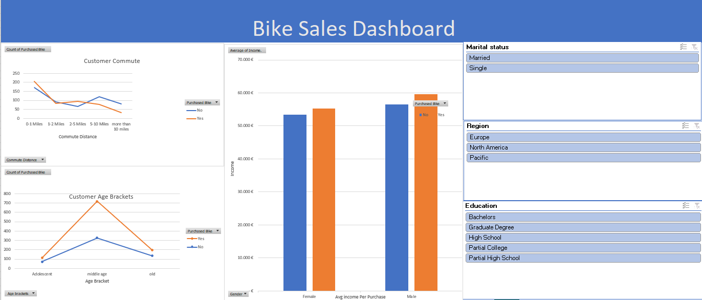

# Bike Sales Dashboard (Excel)

An interactive Excel dashboard that analyses which customers buy bikes.

**Tools:** Excel, Power Query, Pivot Tables, Slicers

## What I did
- Cleaned the raw data with Power Query
- Built pivot tables for commute distance, income by gender and age brackets
- Created an interactive dashboard with slicers for marital status, region and education

## Dashboard

## Files
- `Excel Project Dataset khaoula ess.xlsx`: cleaned data, pivot tables and dashboard
